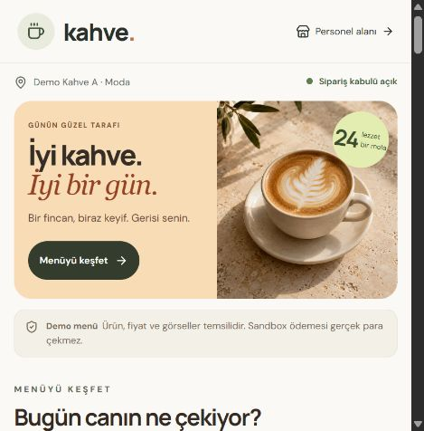
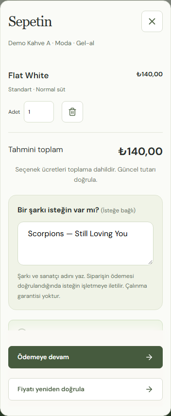

# Kahve — Self-Service Coffee Ordering

A full-stack, multi-tenant ordering application for independent coffee shops. Customers customize drinks, check out through a payment sandbox, and follow their order while staff manage preparation in a live dashboard.

**Stack:** React · TypeScript · Vite · ASP.NET Core 10 · EF Core · PostgreSQL · SignalR · Docker · Playwright

**Status:** Working local MVP with sandbox payments. Not a production payment service; live deployment, refunds and operational rollout remain on the roadmap.

<p>
  
  
</p>

## What the project demonstrates

- **Multi-tenant boundaries:** tenant filters, composite foreign keys and branch-specific staff authorization.
- **Reliable checkout:** server-calculated prices, immutable order snapshots and idempotent checkout/payment handling.
- **Payment integration:** per-merchant iyzico sandbox accounts, server-side verification and reconciliation; a separate local payment simulator for development and tests.
- **Live operations:** SignalR order updates, polling fallback, versioned staff actions and audit records.
- **Customer experience:** responsive product photography, drink options, branch-specific cart drafts and recovery from price changes.
- **Order-linked song requests:** optional text requests, moderation, server-side filters, pagination and pending counts. No music playback or third-party music catalog is required.
- **Automated verification:** PostgreSQL integration tests through Testcontainers, frontend unit tests and browser flows through Playwright.

## Run locally

Requirements: Docker Desktop with Linux containers and PowerShell. For development outside Docker, use .NET 10 and Node.js 24.

```powershell
./scripts/init-env.ps1
docker compose up -d --build --wait
```

Open the [customer menu](http://127.0.0.1:5187/b/demo-moda), [staff dashboard](http://127.0.0.1:5187/staff) or [merchant admin](http://127.0.0.1:5187/admin). The setup script creates local secrets; payment provider credentials are configured separately. Never commit `.env`.

## Architecture and product decisions

The API keeps pricing, payment confirmation and tenant authorization on the server. PostgreSQL transactions and an outbox keep verified payments connected to order processing. The web app handles discovery and interaction while server state remains authoritative.

See the [architecture](docs/architecture.md), [payment state machine](docs/payment-state-machine.md), [current UX roadmap](docs/product-experience-roadmap-2026-10-19.md) and [song request flow](docs/music.md). Product screenshots use illustrative demo photography; menu prices and accounts are for local testing.

## Türkçe kurulum ve operasyon

### Kahve self-servis MVP

Bağımsız kahveciler için çok işletmeli sipariş platformu. **Aşama 0–5 ve iyzico sandbox ödeme bağlantısı tamamlandı**: menü/sepet → ödeme → barista panosu → canlı takip → teslim ve işletme yönetimi. Bu depo yerel geliştirme içindir.

## Çalışan kapsam

- React + TypeScript müşteri menüsü: `/b/{slug}`, kategori, arama, şubeye özel fiyat/uygunluk ve sipariş kabul durumu.
- Boy/süt/ekstra seçenekleri, zorunlu seçim ve maksimum seçim kuralları; şube bazında seçenek fiyatı/uygunluğu.
- Adetli, şubeye özel misafir sepeti. Aynı seçimler birleşir; sayfa yenilendiğinde aynı sekmede sepet korunur.
- `POST /api/checkouts/quote`: güncel katalogdan fiyat doğrulama, tutar/ürün/seçenek özeti; istemcinin fiyatına güvenilmez.
- Checkout: onaylanan toplamın yeniden doğrulanması, aynı anahtarda tek işlem, 15 dakikalık sandbox oturumu ve kalıcı fiyat/ürün snapshot'ı.
- Kart bilgisi istemeyen demo ödeme ekranı; imzalı sunucu bildirimi, yinelenen olay kontrolü, başarısız/sona eren ödeme durumları.
- Güvenli sipariş takip bağlantısı, sipariş numarası ve ödeme onayı; PostgreSQL outbox worker ile Paid → Received aktarımı ve kalıcı retry.
- Personel panelinde şube QR kodu, PNG indirme ve yazdırma; paylaşılabilir site adresi girilebilir.
- ASP.NET Core 10 + EF Core + PostgreSQL; sürümlü migration.
- HttpOnly cookie personel oturumu, CSRF, giriş rate limit, Owner/Barista rol kontrolü.
- İşletme sorgu filtreleri, personel şube yetkisi ve çapraz işletme ilişkilerini engelleyen veritabanı foreign key'leri.
- `/staff`: yetkili şubeler, kabulü aç/kapat, sürüm çakışması kontrolü ve aynı işlemde audit kaydı.
- Barista panosu: Yeni/Hazırlanıyor/Hazır sütunları, ödeme onayı, ürün/seçenek/adet detayları, bekleme süresi ve büyük işlem butonları; teslim edilen kayıt aktif kuyruktan çıkar.
- SignalR: yetkili şube ve sipariş grupları, reconnect sonrası yeniden yetkilendirme ve güncel durum yükleme; bağlantı kurulamazsa polling fallback.
- Durum PATCH'i expectedVersion ile çakışmayı bildirir; offline ekran işlem yapmış gibi görünmez. Yeni sipariş bildirimi ve kullanıcının açabildiği sesli uyarı.
- Açıkça işaretli iki demo işletme, dört şube, işletme başına 24 ürün ve toplam dört personel hesabı.
- PostgreSQL container üzerinde entegrasyon testleri, frontend testleri, tarayıcı testleri ve CI tanımı.
- `/admin`: işletme sahibi için kategori/ürün/seçenek düzenleme, şube fiyatları ve bulunurluk, çalışma saatleri, şube ekleme/QR, personel daveti/yetkileri ve tarih aralıklı raporlar.
- `/invite/{token}`: 24 saat geçerli, tek kullanımlık davetle parola oluşturma; otomatik e-posta gönderimi yok.
- Fotoğraflı premium müşteri menüsü: 6 kategoride 24 demo ürün, optimize WebP görseller, sıcak kayısı tonları, renkli kategori filtreleri, ürün detay fotoğrafı ve görsel hata durumunda kullanılabilir kartlar. Demo görselleri üretilmiş ve temsilidir.
- Owner ürün düzenleme ekranında JPG/PNG/WebP yükleme, değiştirme ve kaldırma. İşletme/sürüm/CSRF kontrolü, 5 MB ve 16 megapiksel sınırı, normalize/metadata temizliği. Fotoğraflar `catalog-images` Docker volume'unda korunur.
- Sepette isteğe bağlı 240 karakter şarkı/sanatçı isteği. Ödeme doğrulanınca sipariş numarasıyla `/admin` → **İstek parçalar** ve personel panosuna düşer; işletme kabul/reddeder. Katalog, müzik API'si veya oynatıcı gerekmez. [Kullanım ve API](docs/music.md).

iyzico Checkout Form sandbox entegrasyonu işletmeye özel hesapla çalışır; hosted kart sayfası, HTTPS callback, imzalı server-side sonuç sorgusu ve kalıcı uzlaştırma bağlandı. 13 Ekim 2026'da dış iyzico sandbox + test kartı + mock 3D Secure + callback dönüşü ile 140 TL'lik sipariş Paid → Received olarak doğrulandı. Sandbox gerçek para çekmez. Canlı tahsilat, iade/iptal ve PWA offline desteği henüz uygulanmadı. Canlı bağlantı açıksa ekran olaylarla yenilenir ve 30 saniyede doğrulanır; bağlantı yoksa 2 saniyelik polling devreye girer. Ağ tamamen yokken personel butonları devre dışıdır.

iyzico hesabı, geçici HTTPS bağlantısı ve ödeme modu kurulumu: [iyzico sandbox](docs/iyzico-setup.md). Anahtarı olmayan işletme için ödeme kapalıdır; başka işletmenin hesabı kullanılmaz.

## Docker ile başlatma

Docker Desktop açık olmalı (Linux containers). Proje kökünde PowerShell:

```powershell
./scripts/init-env.ps1
docker compose up -d --build --wait
```

Müşteri: http://127.0.0.1:5187/b/demo-moda  
İkinci işletme: http://127.0.0.1:5187/b/demo-besiktas  
Personel: http://127.0.0.1:5187/staff  
API sağlık: http://127.0.0.1:5087/api/health

Portlar `.env` içindeki `API_PORT` ve `WEB_PORT` ile değiştirilebilir. PostgreSQL yalnızca localhost:55432 üzerinden açıktır. `.env.example` elle kurulum için kullanılabilir; demo parolası en az 12 karakter olmalı. Gerçek anahtar veya parola commit etmeyin.

Aşama 3'e yükseltirken `./scripts/init-env.ps1` mevcut ayarları korur ve eksik `PAYMENT_WEBHOOK_SECRET` / `TRACKING_ENCRYPTION_KEY` değerlerini ekler. Bu anahtarları aynı veritabanı kullanıldığı sürece koruyun: mevcut ödeme bağlantılarının tekrar üretimi ve webhook doğrulaması bunlara bağlıdır. Sandbox yalnızca Development/Testing ortamında açılır; `Sandbox__Enabled=false` ödeme endpoint'lerini kapatır.

| Hesap | Rol | Yetki |
| --- | --- | --- |
| owner-a@demo.local | Owner | Demo Kahve A, iki şube |
| barista-a@demo.local | Barista | Demo Kahve A, Moda |
| owner-b@demo.local | Owner | Demo Kahve B, iki şube |
| barista-b@demo.local | Barista | Demo Kahve B, Beşiktaş |

Hesapların parolası yerel `.env` dosyasındaki `DEMO_PASSWORD` değeridir. İlk çalıştırmada seed oluşur. Yeniden başlatma veri veya parolaları sıfırlamaz; `.env` değişikliği mevcut kullanıcı parolasını güncellemez.

```powershell
docker compose logs --tail 50 api web
docker compose down
```

`down` veritabanı volume'unu korur. Volume silmek tüm demo verisini siler; normal geliştirmede gerekli değildir.

## Yerel geliştirme / hot reload

.NET 10 SDK ve Node 24 gerekir. Docker uygulaması açıksa önce `docker compose stop api web` ile bu projedeki API/web portlarını boşaltın.

```powershell
docker compose up -d db
dotnet tool restore
./scripts/run-api.ps1
```

Ayrı terminalde:

```powershell
cd apps/web
npm ci
npm run dev
```

Vite aynı origin `/api` çağrılarını 5087 portuna proxy eder; cookie/CSRF için CORS açılmaz. Portları değiştirirseniz Vite proxy yapılandırmasını da güncelleyin.

## Doğrulama

```powershell
dotnet test Kahve.slnx
cd apps/web
npm test
npm run build
# Docker demo stack veya yerel API + Vite çalışırken:
npx playwright install chromium
npm run test:e2e
```

Windows'ta kurulu Edge kullanılabilir: `$env:E2E_BROWSER_CHANNEL='msedge'`, ardından `npm run test:e2e`. Farklı port için `E2E_BASE_URL` ayarlayın. E2E parola olarak `.env` dosyasını veya `DEMO_PASSWORD` ortam değişkenini okur; ayrı bir demo veritabanında çalıştırın. Test şubeyi kısa süre durdurup yeniden açar.

Backend testleri Testcontainers ile ayrı, geçici PostgreSQL başlatır; geliştirme veritabanına dokunmaz. Kapsam: işletme/şube ayrımı, public fiyatlar, rol/CSRF/oturum, sürüm çakışması, audit/FK, seçenek kuralları, checkout/webhook eşzamanlı tekrarları, imza/zaman/tutar kontrolü, snapshot, terminal durumlar, güvenli tracking ve outbox hata/retry. E2E testleri yerel demo DB'de örnek siparişler oluşturur; gerçek ödeme yapmaz.

CI tanımı `.github/workflows/ci.yml` içindedir. Yerelde doğrulandı; uzak CI henüz çalıştırılmadı.

## Sonraki adım

Güncel tasarım, kullanıcı deneyimi, hata riskleri ve uygulama öncelikleri: [19 Ekim ürün ve deneyim yol haritası](docs/product-experience-roadmap-2026-10-19.md). Abonelik ve dış müzik katalog/oynatıcı entegrasyonları kapsam dışıdır.

iyzico ve kahveci başına ayrı hesap modeliyle sandbox checkout/callback/uzlaştırma tamamlandı. Hesap ve callback için [yerel kurulum adımları](docs/iyzico-setup.md).

Kalan kapsam PWA/offline ve demo deploy/performans/güvenlik doğrulamasıdır. Canlı ödeme için kalıcı HTTPS/hesap kabulü ve iade/manuel uzlaştırma operasyonu gerekir. Teknik karar kaydı: [sağlayıcı karşılaştırması](docs/payment-provider-selection.md).

Yerel `.env` içinde `PAYMENTS_PROVIDER=sandbox` demo ödeme akışını seçer (eski `.env` için varsayılan); `iyzico` kendi işletme sandbox hesabını kullanır; `none` yeni checkout'u ve demo endpoint'lerini kapatır. Başka değerler API başlangıcında hata verir. iyzico seçiliyken eski demo sandbox oturumları yalnızca kendi sağlayıcısıyla devam eder. Ayar değişince API'yi yeniden oluşturun: `docker compose up -d api`. Mevcut sipariş verisi korunur.

## İşletme yönetimi

`/staff` içinde işletme sahibi hesabıyla giriş yapıp **İşletme yönetimi** bağlantısını açın. Menü sekmesinde kategori, ürün ve seçenekleri düzenleyin; ürün kartındaki şube butonuyla fiyatı/bulunurluğu değiştirin. Ürünü satışa kapatmak geçmiş sipariş snapshot'larını değiştirmez. Vergi oranı kullanıcı ayarıdır, mevcut fiyatın içindedir ve toplama yeniden eklenmez.

Şube sekmesinde çalışma saatlerini uygulayabilir, manuel sipariş kabulünü değiştirebilir ve QR indirebilirsiniz. Boş haftalık saat listesi saat kısıtlaması olmadığı anlamına gelir. Gece yarısını aşan saat aralıkları bu dilimde desteklenmez. Hazırlık kapasitesi bilgi amaçlıdır; rezervasyon/sipariş limiti uygulanmaz. Mevcut slug değiştirilemez; QR bağlantısı korunur.

Personel davet bağlantısını kendiniz paylaşın. Daveti yenilemek önceki bağlantıyı geçersiz kılar. Aktif hesapların rolü/şube erişimi değiştirilebilir veya hesap pasifleştirilebilir; kendi yönetici erişiminizi kapatamazsınız. Raporlarda satışlar ödeme tarihine, başarısız/iptal kayıtları oluşturma tarihine göre sayılır; hazırlık süresi Preparing → Ready geçmişinden hesaplanır. Tüm şubeler raporu Europe/Istanbul saat dilimini kullanır.

## Demo sepet akışı

Menüde Flat White → Seç → Büyük / Yulaf sütü / Ek espresso → 2 adet → Sepete ekle → Sepeti doğrula. Moda şubesinde sunucu toplamı **430 TL** olarak doğrular. Adet veya seçenek değiştiğinde önceki doğrulama kaldırılır. Şube/ürün/seçenek sonradan kapanırsa API doğrulamayı reddeder; sepet korunur.

Ardından **Sandbox ödemeye geç → Başarılı ödemeyi simüle et**: ödeme doğrulanır, takip bağlantısı ve sipariş numarası açılır; worker siparişi “Alındı” durumuna aktarır. “Başarısız ödemeyi simüle et” siparişi kuyruğa sokmaz; sepet korunur ve yeni ödeme girişimi açılabilir. Yanıt kaybolduğunda aynı checkout anahtarı/sunucu ödeme durumu ile toparlanır; redirect parametresi ödeme onayı sayılmaz.

Ayrı sekmede `/staff` alanına giriş yapın, **Moda** şubesini seçin. Yeni sipariş sayfa yenilemeden panoya gelir. **Hazırlamaya al → Hazır olarak işaretle → Teslim edildi** ilerledikçe müşteri sayfası canlı güncellenir. Şube kabulünü kapatmak önceki ücretli siparişleri tamamlamaya engel değildir. “Sesi aç” yalnızca kullanıcı tıklamasıyla etkinleşir; ekran bildirimi ses kapalıyken de çalışır.

SignalR bildirimleri `RealtimeEvents` tablosunda transaction ile saklanır; yayın hatasında kayıt işlenmemiş kalır ve worker tekrar dener. Uygulama bu dilimde tek API instance ile çalışır; yatay ölçekleme için SignalR backplane/uygun barındırma ayrıca gereklidir. Production TLS proxy kurulurken güvenilir forwarded headers/origin ayarı yapılmalıdır; yerel Nginx ve Vite aynı origin WebSocket proxy'si içerir.

Sepet yalnızca aynı tarayıcı sekmesinde, şubeye özel sessionStorage'da tutulur. Kart veya müşteri kişisel verisi tutulmaz. Yerel `127.0.0.1` adresli QR telefonlarda bu bilgisayara erişim sağlamaz; paylaşım için erişilebilir site adresi gerekir. Bu sürüm internet üzerinde yayınlanmadı.

Canlı öncesinde demo seed kapatılmalı, migration deployment adımına taşınmalı, HTTPS/proxy ve kalıcı Data Protection anahtarları yapılandırılmalı; gerçek sağlayıcı sandbox'ı ve hukuk/muhasebe gereksinimleri doğrulanmalıdır. Bu sürüm canlı ödeme entegrasyonu değildir.
## Siparişe bağlı şarkı isteği

Menü → **Sepetin** → **Bir şarkı isteğin var mı?** alanına şarkı ve sanatçı yazılır; alan isteğe bağlıdır. Siparişin ödemesi doğrulanınca **İstek parçalar** panelinde görünür. Owner yönetimden, yetkili Barista sipariş panosundan takip eder. Liste otomatik yenilenir ve kabul/reddetme destekler. Harici müzik bağlantısı, katalog seçimi ve otomatik çalma yoktur. Ayrıntı: [müzik modülü](docs/music.md).

Eski katalog kayıtları geçmiş veriyi korumak için tutulur; güncel kullanıcı akışı bunları kullanmaz. MusicBrainz dosyası indirmeniz gerekmez.

