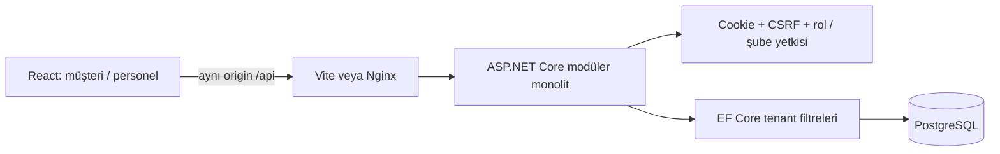

# İlk dilim mimarisi

`Modules/Tenancy`: işletme ve şube. `Modules/Staff`: personel, oturum ve kabul ayarı. `Modules/Catalog`: kategori/ürün/seçenek ve şube override'ları. `Modules/Orders`: ortak pricing, kalıcı Order/snapshot, geçiş kuralları ve durum geçmişi. `Modules/Payments`: checkout, IPaymentProvider/sandbox, HMAC webhook işlemcisi ve PostgreSQL outbox worker. `Infrastructure`: DbContext, scope, migration, demo seed, audit, capability token şifreleme/hash ve transaction advisory locks.

Para decimal(12,2), API para birimi TRY; tarih audit'te UTC. Anonim müşteri menü için hesap açmaz. Özel yönetim verisi cookie yetkisi olmadan alınamaz. Public menü, ürün bulunurluğunu fiyatla birlikte gösterir.

Yeni tenant modülleri tenant filtreleri, server-side yetkilendirme ve crossover testleri eklemelidir; UI gizleme yeterli değildir. Query filter yazma yetkisi yerine geçmez: mutation'da yetkili entity sorgulanmalı, tenant/branch kimliği istemciden körlemesine kabul edilmemelidir.

Quote/checkout RepeatableRead ile bir katalog görünümünden hesaplanır. Checkout key çakışması DB unique constraint ve sınırlı transaction retry ile çözülür. Webhook event/reference ve order advisory locks ile tekrarlar seri işlenir; tutar/para birimi snapshot ile eşleştirilir. Paid + event + history + outbox tek transaction'da saklanır.

Worker FOR UPDATE SKIP LOCKED ile bir outbox kaydı alır, order lock altında Paid → Received yapar ve processedAt'ı aynı transaction'da kaydeder. Hata rollback edilir, nextAttemptAt ve attempts kalıcı güncellenir; yeniden başlatmada bekleyen işler DB'den devam eder. Süresi dolmuş Pending oturumları Expired olur. Sistem worker/global ödeme lookup'ları kontrollü IgnoreQueryFilters kullanır; public istemci branch/tenant grup seçemez.

`Modules/Realtime` SignalR hub, bağlantı yetki kaydı ve transaction outbox yayınlayıcısını içerir. Her status/şube değişimi history/audit ile birlikte RealtimeEvent yazar; worker committed olayı yayınlar. Yayın hatasında processedAt boş kalır ve tekrar denenir. Bildirimler en az bir kez teslim edilebilir; istemci olay payload'ıyla optimistic durum yazmak yerine GET snapshot'ı yeniler.

Personel bağlanırken ve branch event'i gönderilirken yetki yeniden kontrol edilir. Anonim müşteri yalnızca kendi token'ı ile order grubuna katılır. Reconnect sonrası join + GET yapılır; ilk bağlantı hataları da yeniden denenir. Canlı bağlantı yoksa 2 saniye polling; açıkken 30 saniyelik uzlaştırma. Nginx ve Vite WebSocket proxy destekler. Tek API instance hedeflenir; çok instance/backplane henüz eklenmedi.

Tracking/session bağlantıları bearer capability'dir; Nginx access log kapalı, ASP.NET request başlangıç/bitiş logları azaltılmış, Referrer-Policy no-referrer'dır. Secret'lar frontend'e veya Git'e yazılmaz. SignalR tracking token'ı query string yerine JoinTracking mesajıyla alınır. Staff HTTP mutation'ları CSRF gerektirir; hub yalnızca yetkili abonelik/read event işlemleri sunar, browser origin kontrolü uygulanır.
